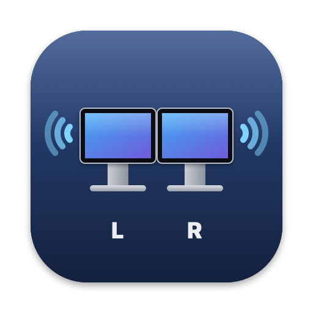

<p align="center"></p>

# Thunderbolt Displays Audio

**Play your Mac's sound through the speakers of two Apple Thunderbolt Displays at once, with the volume keys still working.**

## What it does

A Mac can normally only send sound to one display's speakers. This small menu bar app makes both of your Apple Thunderbolt Displays play together, like one pair of speakers. Your keyboard's volume and mute keys keep working, and you can choose which screen plays the left channel and which plays the right.

## How it does it

You pick one of your displays as the sound output, as usual. The app quietly listens to what your Mac is sending to that display and plays the same sound through the other display too, keeping both in time. When you press the volume keys, it moves the second display's volume with the first.

The first time it runs, macOS asks whether the app may record the sound your Mac plays. It needs that permission to copy the sound to the second display. It never uses your microphone, nothing is saved, and no sound leaves your Mac. While it's working you'll see a small purple dot next to Control Center in the menu bar. That's macOS telling you an app is handling system sound.

## Why it matters

- **Fuller sound.** Two displays' speakers fill a room far better than one, without buying external speakers.
- **Real stereo across your desk.** Put the left channel on the left screen and the right channel on the right one for a wide stereo picture.
- **Hearing help.** macOS no longer offers a balance slider for most devices. This app has one, plus a level control for each display, which helps if you hear less in one ear or one display sounds quieter.
- **Volume keys just work.** Apple's built-in way of combining speakers switches the volume keys off. This app keeps them working.

## Download

**[Download the latest version](https://github.com/andresurena/thunderbolt-display-audio/releases/latest/download/Thunderbolt-Displays-Audio.zip)** · [all releases](https://github.com/andresurena/thunderbolt-display-audio/releases/latest)

You need macOS 14.2 (Sonoma) or later and two Apple Thunderbolt Displays connected. It has been tested on macOS 26 with two Apple Thunderbolt Displays.

## First run

1. Unzip the download and drag **Thunderbolt Displays Audio** into your Applications folder, then open it.
2. **macOS will say it can't check the app for malware.** This happens because the app is signed with a developer certificate but not yet notarised by Apple. To allow it, open **System Settings › Privacy & Security**, scroll down, click **Open Anyway** next to "Thunderbolt Displays Audio", and confirm. You only do this once.
3. When macOS asks whether the app may **record system audio**, click **Allow**.
4. A small two-screens icon appears in the menu bar. Choose one of your displays ("Display Audio") as the sound output in the menu bar's sound menu, or click **Use Thunderbolt Displays as Output** in the app's menu.
5. In the app's menu, tick **Open at Login** so it starts with your Mac.

## Using it

Everything lives in the menu bar icon:

- **Speakers** lists your displays from left to right. Each one lets you choose stereo, left only, right only or mono, set its **Level** if it sounds quieter, and **Identify** it. Identify draws a red outline on that screen and plays three beeps through its speakers, so you know which is which.
- **Position** works out which display is on your left from your arrangement in System Settings › Displays. You can also set it by hand.
- **One Display per Channel** sends the left channel to your left display and the right channel to your right one. **Swap Left and Right** flips them.
- **Balance** shifts the sound towards one side.
- Your choices are remembered, even if you unplug a display.

---

## The technical part

Everything below is for developers and the curious. You don't need any of it to use the app.

### How it works in detail

```
apps ──▶ Display Audio #1 (the Mac's output device; volume keys drive it natively)
              │  Core Audio process tap, muted at the source while tapped
              ▼
   Thunderbolt Displays Audio.app (menu bar)
     • private aggregate device: [Display Audio #1 (clock) ▸ Display Audio #2] + tap
     • Core Audio drift-corrects display #2 and the tap onto display #1's clock
     • IO callback writes the tapped stereo into each display, routed per display
     • mirrors display #1's hardware volume (in dB, plus each display's level trim) and mute to display #2
```

- The app only routes while the Mac's output device is one of the Thunderbolt Displays. Pick any other output and it goes idle; pick a display again and it resumes.
- The tap excludes the app's own process, so its output is never tapped back into itself.
- The IO proc's input is limited to the tap stream (`kAudioDevicePropertyIOProcStreamUsage`), so the displays' microphones are never started and macOS shows no orange microphone indicator.
- Each Thunderbolt Display reports the same serial to CoreGraphics (`CGDisplaySerialNumber`) as its "Display Audio" USB device carries in its UID. That is how audio devices are matched to screens for Identify and automatic placement.
- Level trim works on hardware volume: the other display follows the main one's dB value plus the trim difference. If a boost exceeds a display's hardware maximum, the shortfall is taken off the other displays in software, so nothing clips.
- The test tone uses its own short IO proc on the chosen display, so it plays even while nothing else does.
- Everything runs at 48 kHz.

### Safeguards

- Startup of the tap runs off the main work queue. If macOS is waiting on the permission prompt (it can't show one while the screen is locked), the menu says so instead of freezing.
- The app rebuilds its routing when displays are plugged in or removed, when the output device changes, and when Core Audio restarts.
- Only one copy can run at a time.

### Build from source

Requires Xcode command line tools (Swift 6 toolchain, Swift 5 language mode).

```bash
scripts/build.sh       # Build/Thunderbolt Displays Audio.app
scripts/install.sh     # copies it to /Applications, adds a login item (LaunchAgent), starts it
scripts/uninstall.sh
scripts/make-icon.sh   # regenerates Helper/AppIcon.icns from Tools/MakeIcon.swift
```

The build signs with your first "Apple Development" identity if one exists, otherwise ad hoc; set `SIGN_IDENTITY` to override. `install.sh` needs no password on an admin account. It waits for launchd to finish unloading a previous copy and fails loudly if the app doesn't start. Quit from the menu stops the app until next login; launchd only restarts it after a crash.

Upgrading from the first, plugin-based version: `scripts/remove-legacy-plugin.sh` removes the old "Thunderbolt Displays" virtual device (needs your password, restarts coreaudiod).

### Project layout

| Path | What it holds |
| --- | --- |
| `Helper/FanOut.swift` | The tap, the aggregate device, the real-time IO callback and volume mirroring |
| `Helper/Coordinator.swift` | Watches devices and the output, starts and rebuilds the routing |
| `Helper/Screens.swift` | Matching displays to screens, placement, the red outline |
| `Helper/TestTone.swift` | The identify beeps |
| `Helper/main.swift` | The menu bar menu |
| `Tools/MakeIcon.swift` | Draws the app icon |

Log: `~/Library/Logs/ThunderboltDisplays.log` (also under **Show Log** in the menu).

### Known limits

- Only tested with Apple Thunderbolt Displays. Other displays whose speakers appear as "Display Audio" over USB may work; set `TBD_DISPLAY_DEVICE_NAME` in the environment to match a different device name. Untested.
- Releases are signed with an Apple Development certificate and are not notarised, hence the Open Anyway step above.

## Licence

MIT. See [LICENSE](LICENSE).

Not affiliated with or endorsed by Apple. Thunderbolt and Apple Thunderbolt Display are trademarks of Apple Inc.
